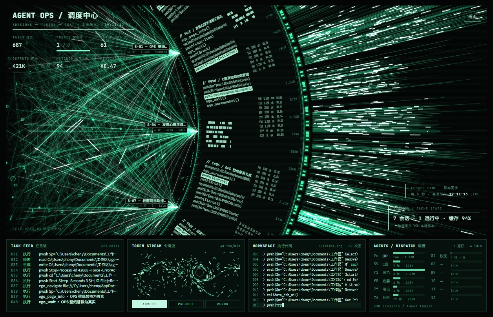
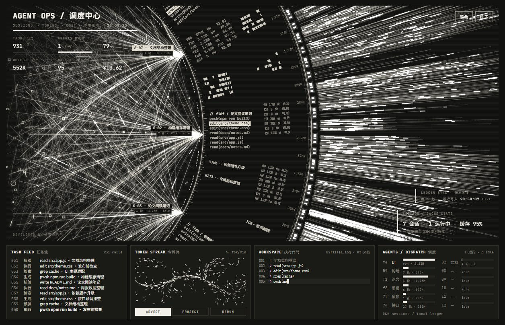
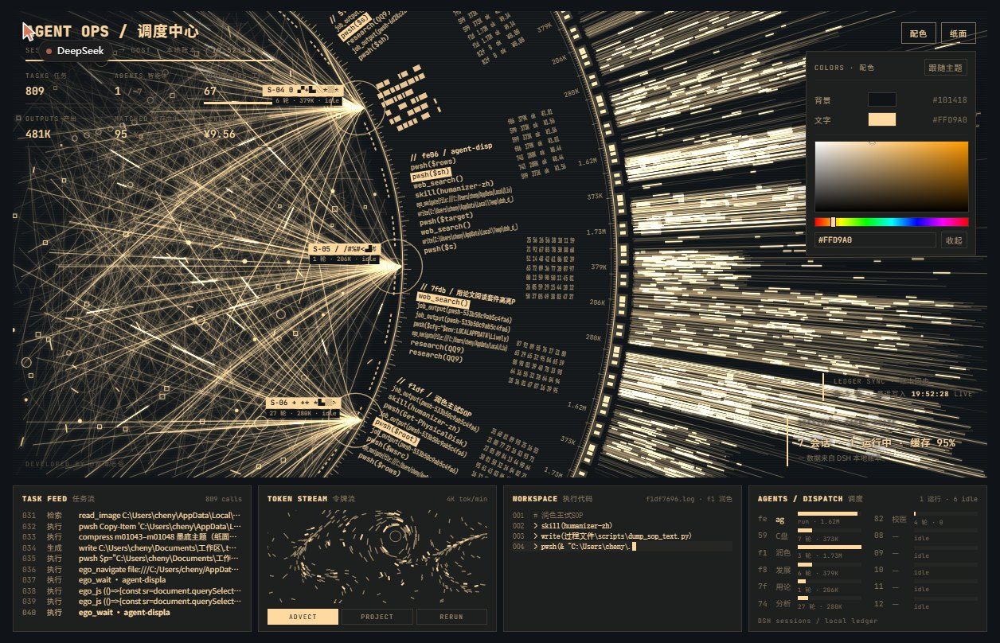
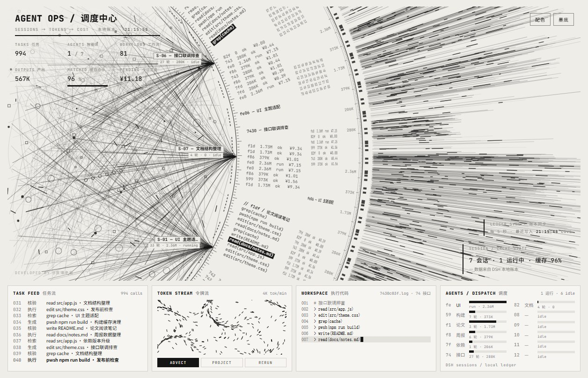
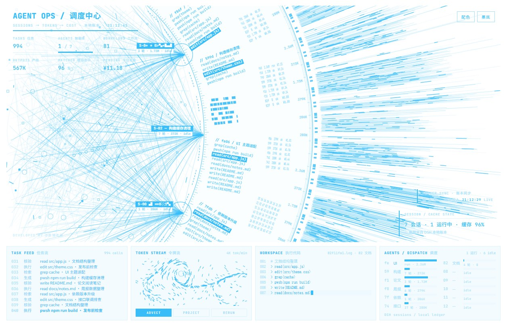
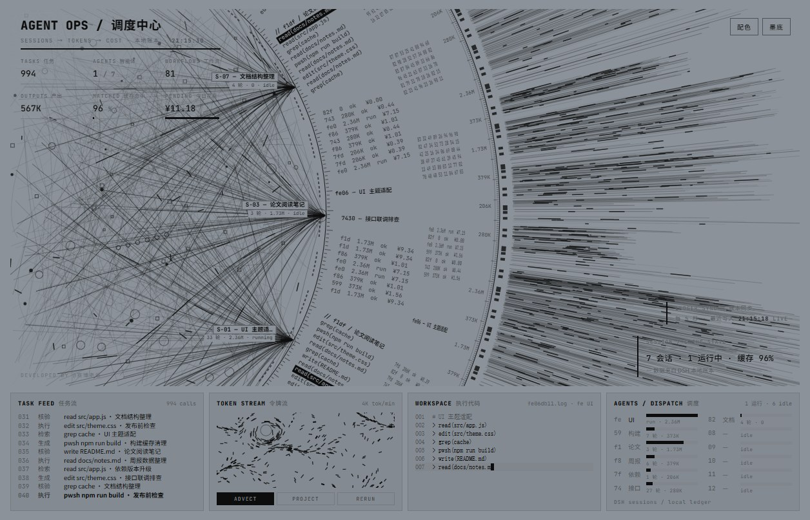

# Agent OPS · DSH — a live Windows wallpaper

Turns the **OPS** dashboard from [agent-display](https://github.com/cyberdaddyleo/agent-display) into a **Windows live wallpaper**, wired to your own machine's real DSH data: sessions, tokens, cache-hit rate and spend — read from local ledgers, not demo numbers.

[中文说明](README.md)



<p align="center">
  
  
</p>

**The same page in different palettes** (only two colors are set in the panel):

<p align="center">
  
  
  
</p>

---

## Features

- **Real data**: session titles, tool-call stream, tokens, cache-hit rate, today's spend and account balance all come from the local ledgers under `%USERPROFILE%\.dsh`, refreshed every 5 seconds
- **Three themes**: Particles (neon green) / Paper (light) / Ink (dark) — one button cycles through them and the choice is remembered
- **Two-color palette**: pick only a background and a text color; the other 14 color variables are derived proportionally, so it stays legible no matter what
- **Follows the system palette**: after a color change (or theme switch) the wallpaper background drives Windows light/dark mode and the text color becomes the system accent color — one current-user registry write per change, no tray app, no polling
- **Zero overhead**: the data bridge runs windowless, offline, never calls a model, never spends a token — it only reads local files
- **No layout changes**: every value is written into the existing cards and labels; no overlay was added

---

## Install

### Option 1 — release package (recommended)

1. Download `agent-ops-dsh-wallpaper.zip` from [Releases](../../releases)
2. **Fully extract** it anywhere
3. Double-click **`安装.bat`** (`install.ps1` wrapper)
4. Open Lively → Library → find **Agent OPS · DSH** → right-click **Set as wallpaper**

### Option 2 — clone this repo

```powershell
git clone https://github.com/imcjdbt/agent-ops-dsh.git
cd agent-ops-dsh
.\install.ps1
```

### Requirements

| Item | Requirement |
| --- | --- |
| OS | Windows 10 / 11 |
| Host | [Lively Wallpaper](https://github.com/rocksdanister/lively) (also on the Microsoft Store) |
| Runtime | Node.js **18+** (only to run a small file-reading script) |
| Data | You have used DSH, so `%USERPROFILE%\.dsh` holds a ledger and session logs |

> Node.js is installed once; after that the bridge starts silently at logon. It stays on Node rather than PowerShell because DSH session logs are multi-frame zstd — Node's `zlib` can decompress frame by frame and recover **session titles, tool calls and turn counts**. A built-in-script version could only read the ledger numbers, and the session names and task stream would degrade into placeholders.

---

## Where the data comes from

`live/bridge.mjs` reads these **local files** every 5 seconds and writes `live/live-data.js` for the page:

| File | What is used |
| --- | --- |
| `%USERPROFILE%\.dsh\storages\cost-meter\ledger.json` | Today's tokens, call count, cache reads, spend, per-session breakdown |
| `%USERPROFILE%\.dsh\.dshw-usage.json` | Account balance, today's spend |
| `%USERPROFILE%\.dsh\sessions\<workspace>\session-*\session.v4.jsonl.zstd` | Session titles, turns, tool calls (for TASK FEED / WORKSPACE / hub labels) |

- **Read-only**: never writes to your DSH directory, never edits config
- **Offline**: no network request anywhere in the script
- **No tokens spent**: no model is ever called
- Page numbers trail the ledger by about 5 seconds, which is expected
- Refresh interval can be changed with the `DSH_LIVE_INTERVAL` environment variable (milliseconds)

If a directory is missing the page shows zeros or an empty state instead of failing.

---

## Customize

| Where | What |
| --- | --- |
| Theme button (top right) | Particles → Paper → Ink, stored in `localStorage` |
| Color panel (top right) | Two pickers (background / text), hand-drawn so it works inside Lively's WebView2; the rest is derived. "Follow theme" restores defaults |
| System follow | 400 ms after a change the page POSTs to `127.0.0.1:38765`; the bridge runs `live/set-system-theme.ps1` to write HKCU Personalize / DWM values |
| `:host` block in `index.html` | The 16 color variables of all three themes, if you prefer hard-coding |
| `mountOps()` | The data mapping logic — change the fields here |

---

## FAQ

**"Lively wallpaper library not found"**
Lively is not installed, or it lives in a non-default location. Install Lively first.

**"Node.js not detected"**
Install the LTS build from https://nodejs.org/, then **open a new terminal** before running the installer again (PATH must be refreshed).

**The wallpaper is black**
Almost always a blocked navigation: Lively only loads files inside the wallpaper folder. This installer places everything directly in that folder, so it should not happen; if it does, check the newest log under `%LOCALAPPDATA%\Lively Wallpaper\logs\`.

**Numbers are frozen / the HUD shows STALE**
The bridge is not running. Double-click `%LOCALAPPDATA%\Lively Wallpaper\Library\wallpapers\agent-ops-dsh\live\start-bridge.vbs`. The `LEDGER SYNC` field turns `STALE` after 15 seconds without an update.

**Colors changed but Windows theme did not**
The bridge is not running, or it is an older build. Check that `live-data.js` keeps updating, restart `live\start-bridge.vbs`, then change a color again. Only edits made from the wallpaper page sync; editing `index.html` directly does not.

**Buttons on the wallpaper do not respond**
Lively forwards mouse input by default (`InputForward`). If it is off, open the same `index.html` in a browser, adjust there, and copy the `localStorage` value over.

---

## Update & uninstall

- **Update**: extract the new package over the old one and run `安装.bat` again (keeps `live-data.js` and your colors)
- **Uninstall**: run `uninstall.ps1`, then remove the dead entry in Lively

---

## Credits & license

- Visuals and interaction by **[cyberdaddyleo / agent-display](https://github.com/cyberdaddyleo/agent-display)** (赛博老爸), licensed **PolyForm Noncommercial 1.0.0**
- This repo is a **localized wrapper** around that work: it rewires the OPS theme to the local DSH ledger, adds a third theme and a two-color palette, and adds the Lively installer. **The page layout is unchanged**
- Under the original license: **free for non-commercial use; commercial use requires permission from the original author**; keep `LICENSE` and the on-page `Required Notice: Copyright (c) 2026 赛博老爸`
- The new `live/` scripts and `install.ps1` are released under the same license

## File map

```
.
├─ index.html            single-file dashboard (10 themes; changes here target OPS)
├─ lively.html           Lively entry page (redirects to index.html#ops)
├─ LivelyInfo.json       Lively wallpaper metadata
├─ lively_t.jpg          wallpaper thumbnail
├─ install.ps1           installer
├─ 安装.bat              double-click wrapper for install.ps1
├─ uninstall.ps1         uninstaller
├─ package.ps1           build the release zip (dist/agent-ops-dsh-wallpaper.zip)
├─ LICENSE               original license
└─ live/
   ├─ bridge.mjs         data bridge: reads .dsh every 5 s, writes live-data.js
   ├─ bind.js            page side: polls the data, reloads when index.html changes
   ├─ start-bridge.vbs   windowless launcher (used at logon)
   └─ set-system-theme.ps1  syncs Windows light/dark mode and accent color with the wallpaper
```
