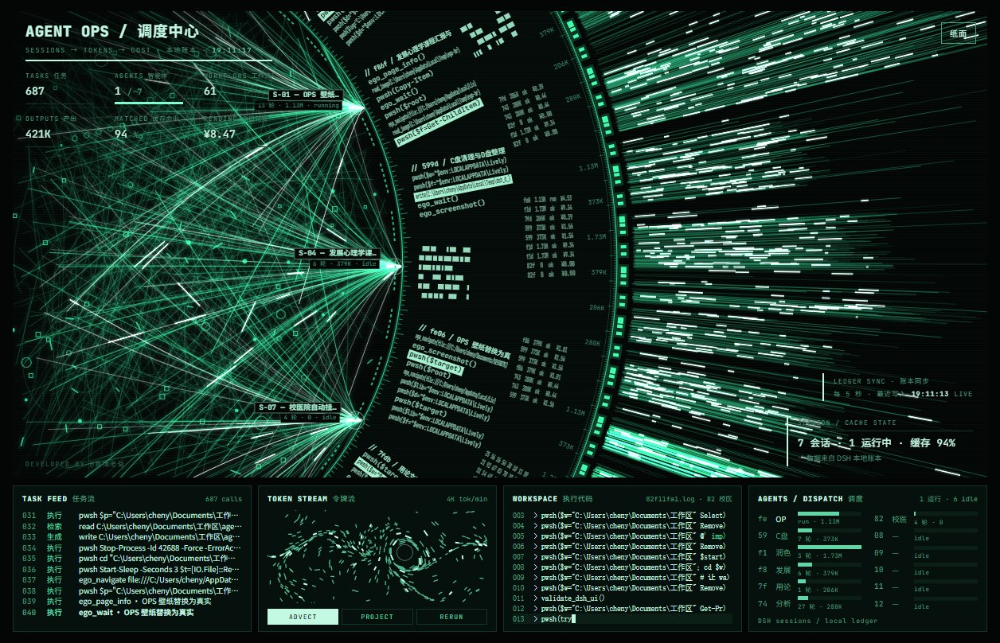
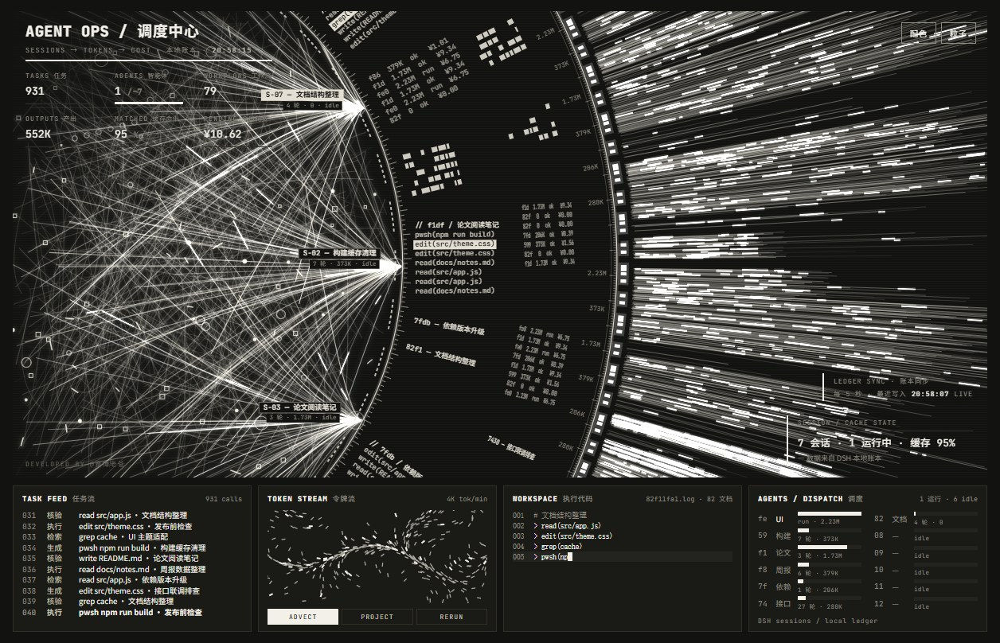
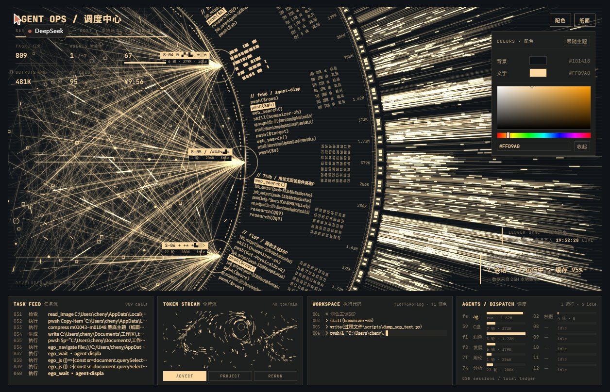
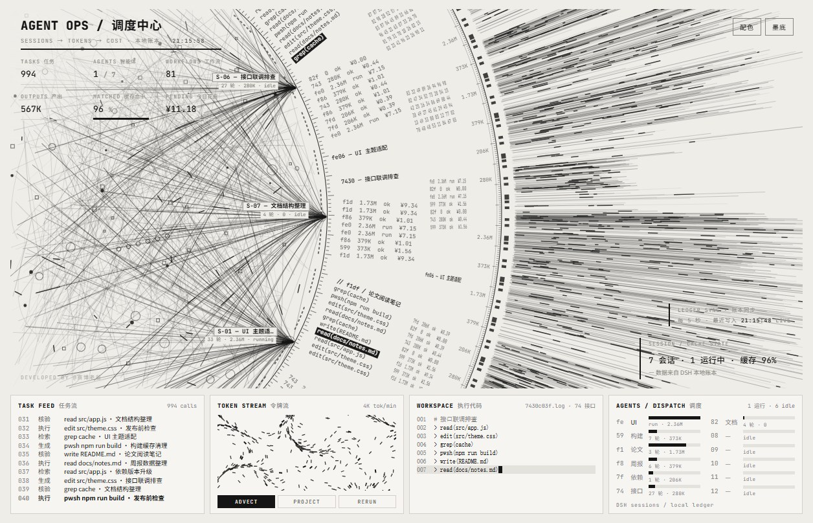
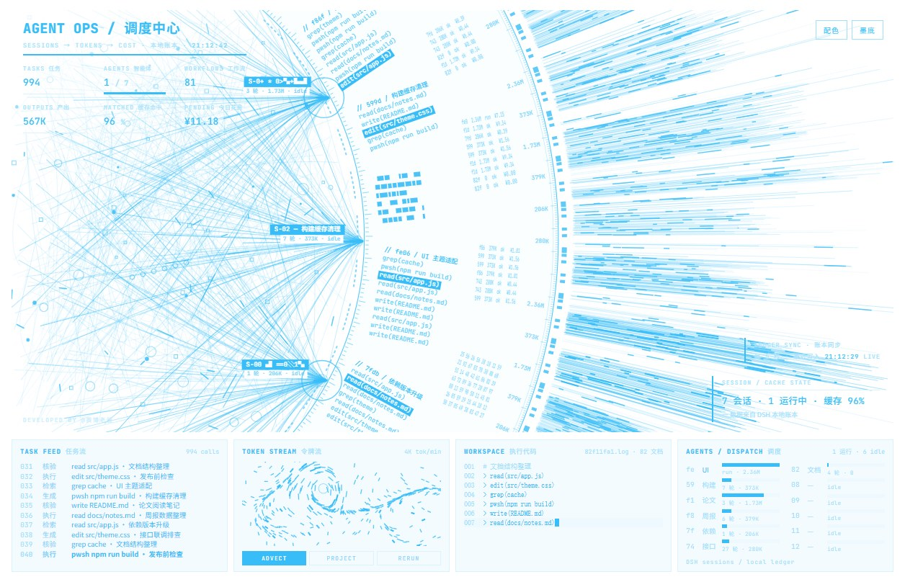
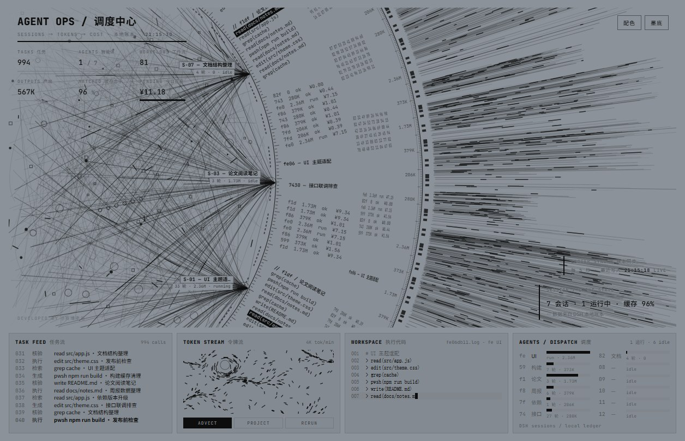

# Agent OPS · DSH 桌面壁纸

<p align="center"><b>中文</b> · <a href="README.en.md">English</a></p>

把 [agent-display](https://github.com/cyberdaddyleo/agent-display) 的 OPS 大屏做成 **Windows 动态壁纸**，并且把屏幕上那些数字换成**你自己电脑上 DSH 的真实数据**：今天开了几个会话、跑了多少 token、缓存命中多少、花了多少钱，全部来自本机账本。



<p align="center">
  
  
</p>

**同一套页面的不同配色**（配色面板里只调两个颜色即可）：

<p align="center">
  
  
  
</p>

---

## 特性

- **接真实数据**：会话标题、工具调用流水、token、缓存命中率、今日花费、账户余额，全部来自 `%USERPROFILE%\.dsh` 下的本地账本与会话日志，每 5 秒刷新
- **三套主题**：粒子（荧光绿）/ 纸面（白底墨字）/ 墨底（黑底米白），点一下循环切换，会记住
- **两色配色**：只选「背景」和「文字」两个颜色，其余 14 个颜色变量按比例派生，怎么配都不花
- **跟随系统配色**：改完颜色（或换主题）后，壁纸底色自动换算成 Windows 浅色/深色、文字色自动设成系统强调色；每次改色只写一次当前用户的注册表，不常驻、不轮询
- **零打扰**：数据桥接无窗口静默运行，不联网、不调模型、不花 token，只读本地文件
- **无布局改动**：所有数据都填在原有卡片/文字位里，不新增任何浮层

---

## 安装

### 方式一：下载发行包（推荐）

1. 到 [Releases](../../releases) 下载 `agent-ops-dsh-wallpaper.zip`
2. **完整解压**到任意位置
3. 双击 **`安装.bat`**
4. 打开 Lively → 壁纸库 → 找到 **Agent OPS · DSH** → 右键 **Set as wallpaper**

### 方式二：克隆本仓库

```powershell
git clone https://github.com/imcjdbt/agent-ops-dsh.git
cd agent-ops-dsh
.\install.ps1
```

### 前置条件

| 项 | 要求 |
| --- | --- |
| 系统 | Windows 10 / 11 |
| 壁纸宿主 | [Lively Wallpaper](https://github.com/rocksdanister/lively)（Microsoft Store 也有） |
| 运行环境 | Node.js **18+**（只用来跑一个读文件的脚本） |
| 数据 | 用过 DSH，`%USERPROFILE%\.dsh` 里有账本和会话记录 |

> Node.js 装一次即可，之后开机自动静默运行。之所以坚持用 Node 而不是塞进 PowerShell，是因为 DSH 的会话日志是多帧 zstd 压缩，Node 的 `zlib` 能逐帧解压出**会话标题、工具调用、轮次**；换成系统自带脚本只能读到账本数字，右边那些会话名和任务流就没了。

---

## 数据是怎么来的

`live/bridge.mjs` 每 5 秒读一次下面这些**本机文件**，生成 `live/live-data.js` 供页面读取：

| 文件 | 用到的内容 |
| --- | --- |
| `%USERPROFILE%\.dsh\storages\cost-meter\ledger.json` | 今日 token、调用次数、缓存读、花费、逐会话明细 |
| `%USERPROFILE%\.dsh\.dshw-usage.json` | 账户余额、今日花费 |
| `%USERPROFILE%\.dsh\sessions\<工作区>\session-*\session.v4.jsonl.zstd` | 会话标题、轮次、工具调用（用于 TASK FEED / WORKSPACE / 圆盘标签） |

- **只读**：不修改你的 DSH 目录，不写任何配置
- **不联网**：脚本里没有任何网络请求
- **不花 token**：不调用任何模型
- 页面数字比账本滞后约 5 秒，属正常
- 刷新频率可用环境变量 `DSH_LIVE_INTERVAL`（毫秒）调整

某个目录不存在时页面显示 0 / 空状态，不会报错。

---

## 自定义

| 位置 | 能改什么 |
| --- | --- |
| 右上角主题按钮 | 粒子 → 纸面 → 墨底 循环，写入 `localStorage` |
| 右上角「配色」 | 背景 / 文字两个取色器（自绘，不依赖系统对话框），其余变量自动派生；「跟随主题」一键还原 |
| 自动跟随系统 | 改色后 400 ms 内 POST 到 127.0.0.1:38765，由桥接调用 live/set-system-theme.ps1 写入 HKCU 的 Personalize / DWM 键 |
| `index.html` 的 `:host` 块 | 三套主题的 16 个颜色变量，想硬改直接改这里 |
| `mountOps()` | 数据映射逻辑，想换字段从这里下手 |

---

## 常见问题

**装完提示「没有找到 Lively 的壁纸库」**
Lively 没装或装在非默认位置。先装 Lively 再运行安装脚本。

**装完提示「没有检测到 Node.js」**
去 https://nodejs.org/ 装 LTS，装完**重开一个终端**再运行（PATH 才会更新）。

**壁纸全黑**
几乎都是「页面跳转被拦」：Lively 只允许加载壁纸目录内的文件。本安装包把所有文件直接放进壁纸目录，正常情况下不会出现；仍有问题请看 `%LOCALAPPDATA%\Lively Wallpaper\logs\` 最新日志。

**数字不动 / 显示 STALE**
桥接没在跑。双击 `%LOCALAPPDATA%\Lively Wallpaper\Library\wallpapers\agent-ops-dsh\live\start-bridge.vbs` 手动启动一次。HUD 上 `LEDGER SYNC` 超过 15 秒未更新会显示 `STALE`。

**改了配色，但系统深浅/强调色没变**
桥接没在跑，或者还在用旧版桥接。确认 live-data.js 在持续更新；重启一次 live\start-bridge.vbs，再在壁纸里改一次颜色。只有从壁纸页面改色才会同步，直接改 index.html 不会。

**壁纸上的按钮点不动**
Lively 默认转发鼠标事件（设置项 `InputForward`）。若被关掉，只能用浏览器打开同一份 `index.html` 调，然后手工同步 `localStorage`。

---

## 更新与卸载

- **更新**：用新包覆盖解压，重跑 `安装.bat`（保留 `live-data.js` 和你的配色）
- **卸载**：运行 `uninstall.ps1`，再到 Lively 里删掉失效条目

---

## 致谢与许可

- 视觉与交互原作：**[cyberdaddyleo / agent-display](https://github.com/cyberdaddyleo/agent-display)**（作者：赛博老爸），采用 **PolyForm Noncommercial 1.0.0** 许可
- 本仓库是在原作基础上的**本地化封装**：把 OPS 主题的数据源接到 DSH 本地账本、增加三档主题与两色配色、增加 Lively 安装脚本。**未修改任何页面布局**
- 依原许可：**非商业使用免费；商业使用需向原作者取得授权**；请保留 `LICENSE` 与页面上的 `Required Notice: Copyright (c) 2026 赛博老爸`
- 本仓库新增的 `live/`、`install.ps1` 等脚本同样以 PolyForm Noncommercial 1.0.0 发布

## 文件清单

```
.
├─ index.html            单文件大屏（10 个主题，本仓库改动集中在 OPS）
├─ lively.html           Lively 入口页（跳到 index.html#ops）
├─ LivelyInfo.json       Lively 壁纸元数据
├─ lively_t.jpg          壁纸缩略图
├─ install.ps1           安装脚本
├─ 安装.bat              双击运行 install.ps1
├─ uninstall.ps1         卸载脚本
├─ package.ps1           打发行包（生成 dist/agent-ops-dsh-wallpaper.zip）
├─ LICENSE               原项目许可证
└─ live/
   ├─ bridge.mjs         数据桥接：每 5 秒读 .dsh，写 live-data.js
   ├─ bind.js            页面侧轮询 + index.html 变更自动重载
   ├─ start-bridge.vbs   无窗口启动器（开机自启用）
   └─ set-system-theme.ps1  把壁纸底色/文字色写成系统深浅模式与强调色
```
