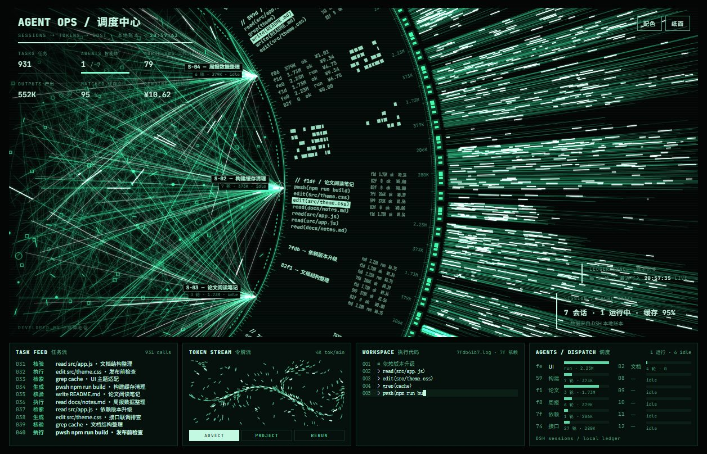

# Agent OPS · DSH wallpaper

Turns the **OPS** theme of [agent-display](https://github.com/cyberdaddyleo/agent-display) into a Windows live wallpaper, wired to **your own machine's real DSH data**: how many sessions ran today, how many tokens, cache-hit rate, how much was spent — all read from local ledgers, not demo numbers.

[中文说明](使用说明.md)



---

## 1. What you need

| Item | Requirement |
| --- | --- |
| OS | Windows 10 / 11 |
| Host | [Lively Wallpaper](https://github.com/rocksdanister/lively) (also on the Microsoft Store) |
| Runtime | Node.js **18+** (only to run a small file-reading script; no network) |
| Data | You have used DSH, so `%USERPROFILE%\.dsh` holds a ledger and session logs |

---

## 2. Install (3 steps)

1. **Extract the whole zip** anywhere (do not run it from inside the archive).
2. Double-click **`安装.bat`** (or right-click `install.ps1` → Run with PowerShell).
   - The script copies the wallpaper into Lively's library
   - and registers the data bridge to start at logon (silent, no window)
3. Open Lively → Library → find **Agent OPS · DSH** → right-click **Set as wallpaper**.

Once installed, the top-right corner is interactive:

- **Particles / Paper / Ink** — three themes, cycled by one button
- **Palette** — pick only "background" and "text"; the other 14 color variables are derived proportionally
- **Follow system** — after a color change, Windows light/dark mode and the accent color are set to match the wallpaper (one registry write per change; otherwise untouched)

---

## 3. Where the data comes from

The bridge `live/bridge.mjs` reads these **local files** every 5 seconds and writes `live/live-data.js` for the page:

```
%USERPROFILE%\.dsh\storages\cost-meter\ledger.json   # tokens, call count, spend
%USERPROFILE%\.dsh\.dshw-usage.json                  # balance, today's spend
%USERPROFILE%\.dsh\sessions\<workspace>\session-*     # session titles, tool calls
```

- **Read-only**: never writes to your DSH directory, never edits config
- **Offline**: no network request anywhere in the script
- **No model calls**: costs nothing
- Numbers trail the ledger by about 5 seconds, which is normal

The refresh interval can be changed with the `DSH_LIVE_INTERVAL` environment variable (milliseconds):

```powershell
set DSH_LIVE_INTERVAL=10000
```

> If a `.dsh` subdirectory does not exist (you never used DSH), the page shows zeros or an empty state instead of failing.

---

## 4. FAQ

**"Lively wallpaper library not found"**
Lively is not installed, or it is installed in a non-default location. Install Lively first.

**"Node.js not detected"**
Install the LTS build from https://nodejs.org/, then **open a new terminal window** and run the installer again (PATH has to refresh).

**The wallpaper is black**
Almost always a blocked navigation: Lively only loads files inside the wallpaper folder. This installer places everything directly in that folder, so it should not happen; if it does, check the newest log under `%LOCALAPPDATA%\Lively Wallpaper\logs\`.

**Numbers are frozen**
The bridge is not running. Double-click `%LOCALAPPDATA%\Lively Wallpaper\Library\wallpapers\agent-ops-dsh\live\start-bridge.vbs` to start it once manually; `LEDGER SYNC` in the top-right corner shows `STALE` when nothing has updated for over 15 seconds.

**Colors changed but the Windows theme did not**
The bridge is not running, or it is an older build. Restart `live\start-bridge.vbs` and change a color again.

**Theme / palette clicks do nothing**
Lively forwards mouse input to the wallpaper by default (`InputForward`). If that is off, open the same `index.html` in a browser, adjust there, and copy the `localStorage` value over — or edit the `:host` color variables in `index.html` directly.

---

## 5. Update & uninstall

- **Update**: extract the new package over the old one and run `安装.bat` again (keeps `live-data.js` and your colors).
- **Uninstall**: run `uninstall.ps1`, then remove the dead entry in Lively.

---

## 6. License & credits

- Visuals and interaction by [cyberdaddyleo/agent-display](https://github.com/cyberdaddyleo/agent-display), **PolyForm Noncommercial 1.0.0** — free for non-commercial use, commercial use needs the original author's permission; keep `LICENSE` and the on-page `Required Notice: Copyright (c) 2026 赛博老爸`.
- This package changes three things: it rewires the OPS data source to the local DSH ledger, adds a color panel, and adds the Lively installer. The data bridge and installer scripts may be modified freely.

---

## 7. File map

```
AgentOPS-DSH/
├─ index.html               single-file dashboard (10 themes, with these changes)
├─ lively.html             Lively entry page, redirects to index.html#ops
├─ LivelyInfo.json         Lively wallpaper metadata
├─ lively_t.jpg            thumbnail
├─ install.ps1             installer
├─ 安装.bat                double-click wrapper for install.ps1
├─ uninstall.ps1           uninstaller
├─ LICENSE                 original license
└─ live/
   ├─ bridge.mjs           data bridge (reads .dsh every 5 s, writes live-data.js)
   ├─ bind.js              page side: polls data; reloads when index.html changes
   ├─ start-bridge.vbs     windowless launcher (used at logon)
   └─ set-system-theme.ps1  syncs Windows light/dark mode and accent color
```
