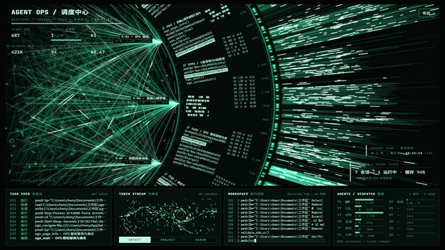

# Agent OPS · DSH 壁纸

把 [agent-display](https://github.com/cyberdaddyleo/agent-display) 的 **OPS 主题**做成 Windows 桌面动态壁纸，并且**接你自己电脑上 DSH 的真实数据**：今天跑了几个会话、多少 token、缓存命中率、花了多少钱，全部来自本机账本，不是演示用的假数据。



---

## 一、需要什么

| 项 | 要求 |
| --- | --- |
| 系统 | Windows 10 / 11 |
| 壁纸宿主 | [Lively Wallpaper](https://github.com/rocksdanister/lively)（Microsoft Store 也有） |
| 运行环境 | Node.js **18+**（只用来跑一个读文件的脚本，不联网） |
| 数据来源 | 用过的 DSH（`%USERPROFILE%\.dsh` 里有账本和会话记录） |

---

## 二、安装（3 步）

1. 把压缩包**完整解压**到任意位置（不要直接在压缩包里双击运行）。
2. 双击 **`安装.bat`**（或右键 `install.ps1` → 使用 PowerShell 运行）。
   - 脚本会把壁纸装进 Lively 的壁纸库
   - 并把数据桥接挂成开机自启（静默，无窗口）
3. 打开 Lively 主界面 → 壁纸库 → 找到 **Agent OPS · DSH** → 右键 **Set as wallpaper**。

装好后右上角可以直接操作：

- **粒子 / 纸面 / 墨底** 三档主题（一个按钮循环切）
- **配色**：只给「背景」和「文字」两个颜色，其余 14 个颜色变量按比例自动派生

---

## 三、数据是怎么来的

桥接程序 `live/bridge.mjs` 每 5 秒读一次下面这些**本机文件**，生成 `live/live-data.js` 供页面显示：

```
%USERPROFILE%\.dsh\storages\cost-meter\ledger.json   # token、调用次数、花费
%USERPROFILE%\.dsh\.dshw-usage.json                  # 余额、今日花费
%USERPROFILE%\.dsh\sessions\<工作区>\session-*       # 会话标题、工具调用
```

- **只读**：不写你的 DSH 目录，不改任何配置
- **不联网**：脚本里没有任何网络请求
- **不调模型**：不消耗 token，也不产生费用
- 页面上的数字比账本滞后约 5 秒，属正常

数据目录可以用环境变量 `DSH_LIVE_INTERVAL`（毫秒）改刷新频率，例如：

```powershell
set DSH_LIVE_INTERVAL=10000
```

> 如果某个 `.dsh` 子目录不存在（比如你还没用过 DSH），页面会显示 0 或空状态，不会报错。

---

## 四、常见问题

**装完显示 “没有找到 Lively 的壁纸库”**
Lively 没装，或者装在非默认位置。先装 Lively 再运行安装脚本。

**装完显示 “没有检测到 Node.js”**
去 https://nodejs.org/ 装 LTS 版，装完**重开一个终端窗口**再运行脚本（PATH 才会更新）。

**壁纸是黑的**
几乎都是「页面跳转被拦」：Lively 只允许加载壁纸目录内的文件。本安装脚本就是把所有文件直接放进壁纸目录里，所以不该再出现；如果还有，检查 `%LOCALAPPDATA%\Lively Wallpaper\logs\` 里最新日志。

**数字不动了**
数据桥接没在跑。双击 `%LOCALAPPDATA%\Lively Wallpaper\Library\wallpapers\agent-ops-dsh\live\start-bridge.vbs` 手动启动一次；页面右上角的 `LEDGER SYNC` 会显示 `STALE` 表示超过 15 秒没更新。

**壁纸上的颜色/主题点了没反应**
Lively 默认会把鼠标事件转发给壁纸（设置里 `InputForward`）。如果关掉了，就在浏览器里打开同一个 `index.html` 调，然后把 `localStorage` 里的值手工搬过去——或者直接改 `index.html` 里 `:host` 的颜色变量。

---

## 五、更新与卸载

- **更新**：用新版压缩包覆盖解压，再运行一次 `安装.bat`（会保留 `live-data.js` 和你调好的配色）。
- **卸载**：运行 `uninstall.ps1`，然后在 Lively 里删掉那个失效条目。

---

## 六、许可与致谢

- 视觉与交互原作：[cyberdaddyleo/agent-display](https://github.com/cyberdaddyleo/agent-display)，**PolyForm Noncommercial 1.0.0** —— 非商业使用免费，商用需要找原作者授权；请保留 `LICENSE` 与页面上的 `Required Notice: Copyright (c) 2026 赛博老爸`。
- 本压缩包只做了三件事：把 OPS 主题的数据源换成 DSH 本地账本、加了配色面板、加了 Lively 安装脚本。数据桥接与安装脚本可自由修改。

---

## 七、文件清单

```
AgentOPS-DSH/
├─ index.html              单文件大屏（10 个主题，含本套改动）
├─ lively.html             Lively 入口页，跳到 index.html#ops
├─ LivelyInfo.json         Lively 壁纸元数据
├─ lively_t.jpg            缩略图
├─ install.ps1             安装脚本
├─ 安装.bat                双击运行 install.ps1
├─ uninstall.ps1           卸载脚本
├─ LICENSE                 原项目许可证
└─ live/
   ├─ bridge.mjs           数据桥接（每 5 秒读 .dsh，写 live-data.js）
   ├─ bind.js              页面侧：每 5 秒拉新数据；index.html 改了会自动重载
   └─ start-bridge.vbs     无窗口启动器（开机自启用它）
```
